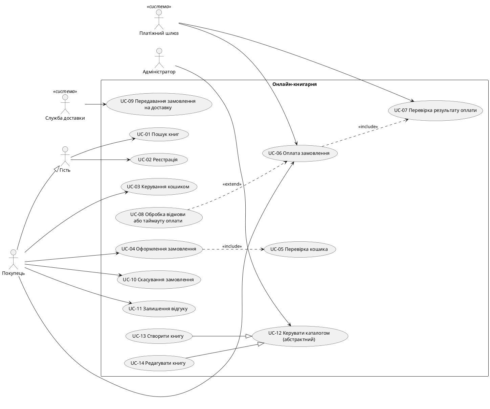

# Завдання 2 — Вимоги та Use Cases

## 1. Актори і цілі
| Актор | Тип | Головна ціль |
|---|---|---|
| Гість | Людина | Переглядати каталог, шукати книги й дивитися інформацію про них без реєстрації. |
| Покупець | Людина | Реєструватися, оформлювати й оплачувати замовлення, залишати відгуки, вести список бажаного. |
| Адміністратор | Людина | Керувати каталогом (книги, автори, видавництва, категорії) і обробляти замовлення. |
| Платіжний шлюз | Зовнішня система | Обробити платіж і повернути результат оплати. |
| Служба доставки | Зовнішня система | Отримати дані про відправлення, доставити замовлення й передавати статус доставки. |

### Узагальнення акторів

| Базовий актор | Спеціалізований актор | Пояснення |
|---|---|---|
| Гість | Покупець | Покупець може все, що Гість, і додатково оформлювати замовлення, оплачувати й залишати відгуки. |

Адміністратор не входить в узагальнення: його можливості (керування каталогом і замовленнями) не є розширенням можливостей Гостя.

## 2. EARS-вимоги
| ID    | Вимога                                                                                                                                                                                                   |
| ----- | -------------------------------------------------------------------------------------------------------------------------------------------------------------------------------------------------------- |
| FR-01 | WHEN Гість або Покупець вводить пошуковий запит, система SHALL відображати Book, у яких `title` або `isbn` містить цей запит.                                                                            |
| FR-02 | WHEN Гість реєструється з унікальним `email`, система SHALL створювати Customer з `id`, `email` і `full_name`.                                                                                           |
| FR-03 | WHEN Покупець додає Book до кошика, система SHALL зберігати `book_id`, `quantity ≥ 1` і ціну книги.                                                                                                      |
| FR-04 | WHEN Покупець оформлює замовлення, система SHALL створювати CustomerOrder зі статусом `new` і пов’язаними OrderItem, у яких `quantity ≥ 1`, а пара `order_id + book_id` є унікальною.                    |
| FR-05 | WHEN Покупець оплачує CustomerOrder, система SHALL надсилати платіжному шлюзу ідентифікатор замовлення та суму до оплати.                                                                                |
| FR-06 | WHEN платіжний шлюз підтверджує успішну оплату, система SHALL змінювати `CustomerOrder.status` на `paid`.                                                                                                |
| FR-07 | IF платіжний шлюз відхиляє оплату або не відповідає протягом 30 секунд, THEN система SHALL залишати `CustomerOrder.status = new` і повідомляти Покупця про відмову або необхідність перевірки платежу.   |
| FR-08 | WHEN CustomerOrder має статус `paid`, система SHALL передавати дані замовлення службі доставки, а після підтвердження відправлення змінювати статус на `shipped`.                                        |
| FR-09 | WHEN Покупець скасовує CustomerOrder зі статусом `new`, система SHALL змінювати його статус на `cancelled`; замовлення зі статусом `paid` або `shipped` не можна скасувати через цей механізм.           |
| FR-10 | WHEN Покупець створює Review для Book, система SHALL приймати `rating` лише від 1 до 5 та забороняти повторний Review для тієї самої пари `customer_id + book_id`.                                       |
| FR-11 | WHEN Адміністратор створює або редагує Book, система SHALL зберігати `title`, `isbn`, `publication_year`, `price`, `publisher_id` і зв’язок щонайменше з одним Author, забезпечуючи унікальність `isbn`. |
| FR-12 | WHILE система зберігає пароль Customer, система SHALL використовувати Argon2id для хешування пароля з унікальною сіллю та не зберігати пароль у відкритому вигляді.  

## 3. Use Cases і діаграма
| ID | Use Case | Актор(и) | Опис |
|---|---|---|---|
| UC-01 | Пошук книг | Гість | Пошук Book за `title` або `isbn`. |
| UC-02 | Реєстрація | Гість | Створення Customer з унікальним `email`. |
| UC-03 | Керування кошиком | Покупець | Додавання Book і зміна `quantity`. |
| UC-04 | Оформлення замовлення | Покупець | Створення CustomerOrder зі статусом `new` і OrderItem. |
| UC-05 | Перевірка кошика | (внутрішній крок UC-04) | Перевірка, що кошик не порожній і кількості допустимі. |
| UC-06 | Оплата замовлення | Покупець, Платіжний шлюз | Надсилання шлюзу ідентифікатора й суми замовлення. |
| UC-07 | Перевірка результату оплати | Платіжний шлюз | Отримання результату платежу й оновлення статусу CustomerOrder. |
| UC-08 | Обробка відмови або таймауту оплати | Покупець, Платіжний шлюз | Статус лишається `new`, Покупець бачить повідомлення. |
| UC-09 | Передавання замовлення на доставку | Служба доставки | Отримання даних замовлення зі статусом `paid` і підтвердження відправлення. |
| UC-10 | Скасування замовлення | Покупець | Скасування CustomerOrder зі статусом `new`. |
| UC-11 | Залишення відгуку | Покупець | Створення Review з `rating` від 1 до 5. |
| UC-12 | Керувати каталогом (абстрактний) | Адміністратор | Узагальнення операцій над Book. |
| UC-13 | Створити книгу | Адміністратор | Створення Book з унікальним `isbn`, Publisher і щонайменше одним Author. |
| UC-14 | Редагувати книгу | Адміністратор | Зміна атрибутів Book зі збереженням `id`. |

### Діаграма




### Зв'язки

| Зв'язок | Тип | Чому |
|---|---|---|
| UC-04 → UC-05 | include | Оформлення завжди включає перевірку кошика перед створенням CustomerOrder. |
| UC-06 → UC-07 | include | Оплата завжди завершується отриманням і обробкою результату від шлюзу. |
| UC-08 → UC-06 | extend | Відмова або таймаут виникають лише за певної умови, тому це необов'язкове розширення оплати. |
| Покупець → Гість | узагальнення акторів | Покупець може все, що Гість, і додатково оформлює й оплачує замовлення. |
| UC-13, UC-14 → UC-12 | узагальнення use case | Створення й редагування книги є різновидами керування каталогом. |

Адміністратор не входить в узагальнення акторів: його можливості не є розширенням можливостей Гостя.

## 4. User stories
| ID | User story |
|---|---|
| US-01 | Як Гість, я хочу шукати книги за назвою або ISBN, щоб знаходити потрібні Book. |
| US-02 | Як Гість, я хочу зареєструватися з унікальним email, щоб стати Customer і оформлювати замовлення. |
| US-03 | Як Покупець, я хочу додавати Book до кошика та вказувати кількість, щоб підготувати покупку. |
| US-04 | Як Покупець, я хочу оформлювати замовлення, щоб отримати CustomerOrder зі статусом `new` і відповідними OrderItem. |
| US-05 | Як Покупець, я хочу ініціювати оплату через платіжний шлюз, щоб сплатити замовлення. |
| US-06 | Як платіжний шлюз, я хочу передавати системі результат оплати, щоб вона могла оновити статус CustomerOrder. |
| US-07 | Як Покупець, я хочу отримувати повідомлення про відмову або затримку оплати, щоб знати стан платежу. |
| US-08 | Як служба доставки, я хочу отримувати дані оплаченого CustomerOrder, щоб організувати відправлення книг. |
| US-09 | Як Покупець, я хочу скасовувати замовлення зі статусом `new`, щоб відмовитися від покупки до оплати. |
| US-10 | Як Покупець, я хочу залишати Review з оцінкою від 1 до 5, щоб ділитися враженнями про Book. |
| US-11 | Як Адміністратор, я хочу створювати та редагувати Book із прив'язкою до Publisher й Author, щоб підтримувати каталог книг. |
| US-12 | Як Customer, я хочу, щоб система зберігала пароль у вигляді захищеного хешу, щоб зменшити ризик розкриття пароля. |

## 5. Gherkin-сценарії
```gherkin
# language: uk

Функціонал: Пошук книг

  @FR-01
  Сценарій: SC-01 Успішний пошук книги
    Дано існує Book з title "Кобзар" та isbn "9780000000001"
    Коли Гість вводить пошуковий запит "Кобзар"
    Тоді система відображає цю Book

  @FR-01
  Сценарій: SC-02 Пошук книги без результатів
    Дано немає Book, у яких title або isbn містить "Невідома книга"
    Коли Гість вводить пошуковий запит "Невідома книга"
    Тоді система відображає порожній список результатів


Функціонал: Реєстрація Customer

  @FR-02
  Сценарій: SC-03 Успішна реєстрація
    Дано email "reader@example.com" ще не використовується
    Коли Гість реєструється з email "reader@example.com"
    І вказує full_name "Іван Петренко"
    І вводить допустимий пароль
    Тоді система створює Customer з унікальним id
    І зберігає email та full_name

  @FR-02
  Сценарій: SC-04 Реєстрація з використаним email
    Дано існує Customer з email "reader@example.com"
    Коли Гість намагається зареєструватися з email "reader@example.com"
    Тоді система відхиляє реєстрацію
    І повідомляє, що email уже використовується


Функціонал: Кошик

  @FR-03
  Сценарій: SC-05 Додавання книги до кошика
    Дано існує Book з id "book-001" та price 250.00
    Коли Покупець додає цю Book до кошика з quantity 2
    Тоді система зберігає book_id "book-001"
    І зберігає quantity 2
    І встановлює ціну книги 250.00

  @FR-03
  Сценарій: SC-06 Додавання книги з недопустимою кількістю
    Дано існує Book з id "book-001"
    Коли Покупець додає цю Book до кошика з quantity 0
    Тоді система відхиляє операцію
    І не додає позицію з недопустимою кількістю


Функціонал: Оформлення замовлення

  @FR-04 @FR-03
  Сценарій: SC-07 Успішне оформлення CustomerOrder
    Дано існує Customer з id "customer-001"
    І у кошику є Book з id "book-001" у кількості 2
    Коли Покупець оформлює замовлення
    Тоді система створює CustomerOrder зі статусом "new"
    І створює пов'язаний OrderItem з quantity 2
    І зберігає unit_price для OrderItem

  @FR-04
  Сценарій: SC-08 Повторення книги в OrderItem одного замовлення
    Дано існує CustomerOrder з id "order-001"
    І для нього вже існує OrderItem з book_id "book-001"
    Коли система намагається додати ще один OrderItem
    І order_id дорівнює "order-001"
    І book_id дорівнює "book-001"
    Тоді система відхиляє створення повторної позиції


Функціонал: Оплата через платіжний шлюз

  @FR-05 @FR-04
  Сценарій: SC-09 Надсилання запиту на оплату
    Дано існує CustomerOrder зі статусом "new"
    І загальна сума замовлення дорівнює 500.00
    Коли Покупець ініціює оплату
    Тоді система надсилає платіжному шлюзу ідентифікатор замовлення
    І передає суму 500.00

  @FR-06
  Сценарій: SC-10 Успішна оплата
    Дано існує CustomerOrder зі статусом "new"
    Коли платіжний шлюз підтверджує успішну оплату
    Тоді система змінює CustomerOrder.status на "paid"

  @FR-07
  Сценарій: SC-11 Відмова в оплаті
    Дано існує CustomerOrder зі статусом "new"
    Коли платіжний шлюз відхиляє оплату
    Тоді система залишає CustomerOrder.status рівним "new"
    І повідомляє Покупця про відмову в оплаті

  @FR-07 @FR-05
  Сценарій: SC-12 Таймаут платіжного шлюзу
    Дано існує CustomerOrder зі статусом "new"
    Коли платіжний шлюз не повертає результат протягом 30 секунд
    Тоді система залишає CustomerOrder.status рівним "new"
    І позначає платіж як такий, що потребує перевірки
    І повідомляє Покупця про необхідність перевірки платежу
    І не повідомляє про успішну оплату без підтвердження


Функціонал: Передавання замовлення службі доставки

  @FR-08 @FR-06
  Сценарій: SC-13 Передавання оплаченого замовлення
    Дано існує CustomerOrder зі статусом "paid"
    І замовлення містить пов'язані OrderItem
    Коли система передає замовлення службі доставки
    І служба доставки підтверджує відправлення
    Тоді система змінює CustomerOrder.status на "shipped"

  @FR-08
  Сценарій: SC-14 Відмова служби доставки
    Дано існує CustomerOrder зі статусом "paid"
    Коли служба доставки відхиляє прийняття замовлення
    Тоді система не змінює статус на "shipped"
    І повідомляє про помилку передавання замовлення


Функціонал: Скасування замовлення

  @FR-09
  Сценарій: SC-15 Скасування замовлення зі статусом new
    Дано існує CustomerOrder зі статусом "new"
    Коли Покупець скасовує замовлення
    Тоді система змінює CustomerOrder.status на "cancelled"

  @FR-09 @FR-06
  Сценарій: SC-16 Скасування оплаченого замовлення
    Дано існує CustomerOrder зі статусом "paid"
    Коли Покупець намагається скасувати замовлення
    Тоді система відхиляє автоматичне скасування
    І повідомляє Покупця, що замовлення не можна скасувати цим способом


Функціонал: Відгуки про книги

  @FR-10
  Сценарій: SC-17 Створення Review з допустимою оцінкою
    Дано існує Customer з id "customer-001"
    І існує Book з id "book-001"
    І цей Customer ще не залишав Review для цієї Book
    Коли Покупець створює Review з rating 5
    І вказує comment "Чудова книга"
    Тоді система зберігає Review
    І записує customer_id та book_id
    І записує rating 5, comment та created_at

  @FR-10
  Сценарій: SC-18 Відхилення недопустимої оцінки
    Дано існує Customer та Book
    Коли Покупець намагається створити Review з rating 6
    Тоді система відхиляє створення Review
    І не зберігає цей відгук

  @FR-10
  Сценарій: SC-19 Повторний відгук для тієї самої книги
    Дано існує Review з customer_id "customer-001"
    І book_id цього Review дорівнює "book-001"
    Коли цей Customer намагається створити ще один Review для "book-001"
    Тоді система відхиляє створення повторного Review


Функціонал: Керування каталогом книг

  @FR-11
  Сценарій: SC-20 Створення Book адміністратором
    Дано існує Publisher з id "publisher-001"
    І існує Author з id "author-001"
    І isbn "9780000000002" ще не використовується
    Коли Адміністратор створює Book
    І вказує title "Нова книга"
    І вказує isbn "9780000000002"
    І вказує publication_year 2026
    І вказує price 300.00
    І вказує publisher_id "publisher-001"
    І пов'язує Book з Author "author-001"
    Тоді система зберігає Book з унікальним id
    І пов'язує Book з Publisher та щонайменше одним Author

  @FR-11
  Сценарій: SC-21 Створення книги з повторним ISBN
    Дано існує Book з isbn "9780000000002"
    Коли Адміністратор створює іншу Book з тим самим isbn
    Тоді система відхиляє створення Book
    І повідомляє про порушення унікальності isbn

  @FR-11
  Сценарій: SC-22 Редагування наявної Book
    Дано існує Book з id "book-001"
    Коли Адміністратор змінює title та price цієї Book
    Тоді система зберігає оновлені title та price
    І не змінює id цієї Book
```
## 6. Матриця трасування
### Вимоги → сценарії → use cases

| Вимога | Сценарії | Use Cases | Статус |
|---|---|---|---|
| FR-01 Пошук книг | SC-01, SC-02 | UC-01 | ✅ |
| FR-02 Реєстрація | SC-03, SC-04 | UC-02 | ✅ |
| FR-03 Кошик | SC-05, SC-06, SC-07 | UC-03, UC-04 | ✅ |
| FR-04 Оформлення замовлення | SC-07, SC-08, SC-09 | UC-04, UC-05 | ✅ |
| FR-05 Ініціювання оплати | SC-09, SC-12 | UC-06 | ✅ |
| FR-06 Успішна оплата | SC-10, SC-13, SC-16 | UC-06, UC-07, UC-09, UC-10 | ✅ |
| FR-07 Відмова та таймаут | SC-11, SC-12 | UC-07, UC-08 | ✅ |
| FR-08 Доставка | SC-13, SC-14 | UC-09 | ✅ |
| FR-09 Скасування | SC-15, SC-16 | UC-10 | ✅ |
| FR-10 Відгуки | SC-17, SC-18, SC-19 | UC-11 | ✅ |
| FR-11 Керування Book | SC-20, SC-21, SC-22 | UC-12, UC-13, UC-14 | ✅ |
| FR-12 Безпека паролів | — | — | ❌ непокрита |

### Use cases → вимоги

| Use Case | Вимоги | Статус |
|---|---|---|
| UC-01 Пошук книг | FR-01 | ✅ |
| UC-02 Реєстрація | FR-02 | ✅ |
| UC-03 Керування кошиком | FR-03 | ✅ |
| UC-04 Оформлення замовлення | FR-03, FR-04 | ✅ |
| UC-05 Перевірка кошика | FR-04 | ⚠️ немає окремого сценарію |
| UC-06 Оплата замовлення | FR-05, FR-06 | ✅ |
| UC-07 Перевірка результату оплати | FR-06, FR-07 | ✅ |
| UC-08 Обробка відмови або таймауту | FR-07 | ✅ |
| UC-09 Передавання на доставку | FR-06, FR-08 | ✅ |
| UC-10 Скасування замовлення | FR-06, FR-09 | ✅ |
| UC-11 Залишення відгуку | FR-10 | ✅ |
| UC-12 Керувати каталогом | FR-11 | ✅ |
| UC-13 Створити книгу | FR-11 | ✅ |
| UC-14 Редагувати книгу | FR-11 | ✅ |

### Непокриті елементи

- **FR-12 (безпека паролів)** не має Gherkin-сценарію і не прив'язана до use case. Це нефункціональна вимога: вона не є ціллю актора і перевіряється не поведінкою користувача, а модульним тестом або ревʼю коду (в БД лежить хеш Argon2id з унікальною сіллю, а не пароль). Сценарій у Gherkin додав би лише штучне «Тоді пароль не показується».
- **UC-05 (перевірка кошика)** не має окремого сценарію: оформлення з порожнім кошиком не перевіряється жодним SC. Це прогалина в сценаріях; її можна закрити сценарієм «Оформлення з порожнім кошиком» (FR-04, UC-05).

## 7. Аудит

### 7.1 EARS на двозначність

| ID | Було (проблема) | Стало |
|---|---|---|
| FR-01 | Не описано поведінку без результатів; не вказано регістр | Непорожній запит без урахування регістру; повідомлення «Книг не знайдено» |
| FR-02 | «Унікальний email» без дії при дублі; пароль без вимог | Пароль ≥ 8 символів; IF email існує — відмова |
| FR-03 | Немає верхньої межі `quantity`; ціна в кошику суперечила FR-04 | `quantity` 1–99; ціна фіксується при оформленні |
| FR-04 | «Оформлює» без умов; не описано порожній кошик | Авторизований Покупець, ≥ 1 Book; порожній кошик — без замовлення; `unit_price = Book.price` |
| FR-05 | Не визначено валюту | Сума = Σ `quantity × unit_price`, UAH |
| FR-06 | Не зберігалася інформація про платіж | Зберігається ідентифікатор транзакції |
| FR-07 | «Відмова або необхідність перевірки» без значень | `declined` / `pending_verification`, таймаут 30 с |
| FR-08 | «Дані замовлення» без переліку; немає відмови доставки | Перелік полів; ідентифікатор відправлення; відмова → статус лишається `paid` |
| FR-09 | Не охоплено `cancelled`; «цей механізм» без пояснення | Явний перелік статусів і поведінка |
| FR-10 | Не вказано, що `rating` ціле; тригер без авторизації | Ціле 1–5, авторизований Покупець, унікальна пара |
| FR-11 | «Зберігати» без перевірок | Перелік перевірок полів; `publication_year` ≤ поточний рік |
| FR-12 | «Унікальна сіль» і «рекомендації» без чисел | Сіль ≥ 16 байтів; параметри Argon2id |

Припущення: межа `quantity` 1–99 є прийнятим обмеженням, а не вимогою з ER-моделі.

### 7.2 include / extend

| Зв'язок | Тип | Перевірка |
|---|---|---|
| UC-04 → UC-05 | include | Перевірка кошика виконується при кожному оформленні, тому include. |
| UC-06 → UC-07 | include | Результат від шлюзу обробляється при кожній оплаті, тому include. |
| UC-08 → UC-06 | extend | Відмова або таймаут виникають лише за умови (FR-07), тому extend; стрілка веде від розширення до базового UC. |

Висновок: типи зв'язків обрано правильно, змін у діаграмі немає.

### 7.3 Звірка з моделлю даних (топ-3 розбіжності)

| № | Розбіжність (spec ↔ ER) | Що виправлено | Коміт |
|---|---|---|---|
| 1 | FR-03 / UC-03 описують кошик, а в ER немає Cart/CartItem | Рішення: кошик існує лише в сесії; уточнено FR-03 і UC-03 | `<hash1>` |
| 2 | FR-06…FR-08 потребують ідентифікатора транзакції, статусу платежу й ідентифікатора відправлення, яких немає в ER | До ER додано сутності Payment і Shipment | `<hash2>` |
| 3 | Актор «Адміністратор» (UC-12…UC-14, FR-11) не має відображення в ER | До Customer додано атрибут role | `<hash3>` |

Сутності Customer, Publisher, Author, Category, Book, CustomerOrder, OrderItem, Review мають відповідні use cases.